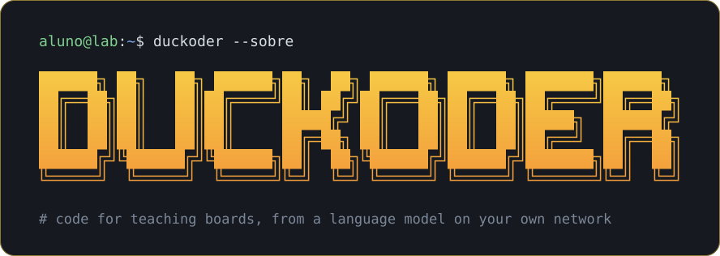

# Duckoder



Web platform that generates code for teaching boards, such as the ESP32 and the Arduino Uno, Mega
and Nano, using a language model that runs locally through [Ollama](https://ollama.com). The student
picks a board, explains to a rubber duck what the board should do, and gets code ready to paste into
the IDE, which can be refined in the same conversation. It works entirely on the local network: no
internet access or paid service is required while it is in use.

Duckoder is the subject of my undergraduate thesis (TCC); the thesis itself is in
[ctrl-vini/rdc-tcc](https://github.com/ctrl-vini/rdc-tcc).

## Requirements

- Python 3.11 or newer
- Ollama

## Setup

```bash
python3 -m venv .venv
source .venv/bin/activate
pip install -r requirements-dev.txt
```

## Language model

Pull a model and check that it answers:

```bash
ollama pull qwen2.5-coder:7b
ollama run qwen2.5-coder:7b --verbose "Write an Arduino sketch for the ESP32 that blinks the built-in LED on GPIO 2."
```

`--verbose` prints the load time and the generation speed after the answer.

To try a request through the platform's own prompt, board profile and model settings:

```bash
python -m scripts.ask_model "Pisque o LED embutido a cada segundo" --board esp32
```

It prints the extracted code, the explanation, the board components the code uses (with any
GPIO it uses that has no component) and the timing; add `--raw` to also see the unparsed reply.
The system prompt lives in `app/prompts/system_prompt.txt`; bump `PROMPT_VERSION` in
`app/services/prompt_builder.py` whenever it changes, so each saved reply records the prompt
that produced it.

## Running

```bash
python server.py
```

The log shows the address to open from any device on the local network: that page is the
interface students use. The interactive API documentation is available at `/docs`. The
interface files are sent with `Cache-Control: no-cache`, so browsers check for a newer version on
every load and an updated interface reaches students with a plain reload.

## The interface

The page looks like a terminal, with a rubber duck in the corner, as in rubber duck debugging:

- Requests are typed at a shell prompt: Enter sends, Shift + Enter adds a line, and the up and
  down arrows bring back what was typed in this conversation, as in a shell; clearing the
  conversation empties that history. While the model works, the waiting line moves on every few
  seconds through the steps of writing a sketch.
- Each reply prints the code as "versão N" with a copy action and the model's explanation. A
  refinement that comes back with the same code as the previous version is flagged.
- `[ ver ligações ]`, on each version, opens the board with only what that code uses: its pins
  highlighted, a drawing of each of its components with the board pin every leg goes to, a notice
  in orange when it moved a component to another pin, and a warning in red for any pin it uses
  that has no component wired to it, usually a pin the model made up.
- The duck, drawn in braille characters, opens and closes its beak while its message is typed
  out and while the explanation of a new reply is typed into the conversation, blinks from time
  to time, and its eye shows whether it is listening, thinking, happy or confused. Its messages
  vary from one request to the next. Animations stop when the system asks for reduced motion.
- The board is picked in the status bar, from a list drawn like a terminal menu that shows each
  board's microcontroller: click it, or focus it and use the arrows, Enter and Esc, or type the
  start of a board's name.
- Picking a board and sending a request starts a conversation; its id goes into the page address
  (`/?conversation=<id>`), so reloading or sharing the link reopens it.

A few words typed at the prompt are commands that the page answers by itself, without the model.
`help` lists them:

| Command | Also | What it does | Shortcut |
| --- | --- | --- | --- |
| `help` | `ajuda` | Prints the commands and their shortcuts | — |
| `pinout` | — | Opens the board in a pane beside the conversation, like a split terminal. Before any code nothing is wired yet, so it marks only the pins nearly every circuit uses, such as GND, 3V3 and VIN, and says what each is for; afterwards, it shows what the latest version uses, following each new version, and `[ placa completa ]` switches back to the bare board. The duck shrinks to one line to make room; on small screens the pane takes the whole screen until `[ fechar ]` | Ctrl + P |
| `clear` | `cls`, `reset`, `clear-host`, `clc` | Asks for confirmation (Enter clears, Esc cancels) and empties the screen; the next request starts a new conversation, so the model no longer sees the earlier messages | Ctrl + L |
| `about` | `sobre` | Shows what Duckoder is, the running version and the credits | Ctrl + S |
| `quack` | — | The duck quacks, with a sound made by the Web Audio API | — |

The status bar buttons `[ ver placa ]`, `[ limpar conversa ]` and `[ sobre ]` do the same, and
hovering over one shows its shortcut; on a Mac the shortcuts use Cmd instead of Ctrl. On this
page they replace the browser's own (address bar, printing and saving), which stay available
from the browser's menu.

It is plain HTML, CSS and JavaScript modules in `static/`, with no build step and nothing loaded
from the internet. The JetBrains Mono NL font is bundled in `static/fonts/` under the SIL Open
Font License: the build without ligatures, so operators such as `<=` show the exact characters to
type, and with its box drawing characters, so the drawings line up on every system.

## Configuration

All settings are environment variables with defaults, so nothing needs to be set to get started.

| Variable | Default | Purpose |
| --- | --- | --- |
| `APP_HOST` | `0.0.0.0` | Network interface the server listens on |
| `APP_PORT` | `8000` | Server port |
| `APP_OLLAMA_URL` | `http://localhost:11434` | Address of the Ollama service |
| `APP_OLLAMA_MODEL` | `qwen2.5-coder:7b` | Model used to generate code |
| `APP_LLM_TEMPERATURE` | `0.7` | Sampling temperature; higher values vary more between runs |
| `APP_LLM_CONTEXT_SIZE` | `8192` | Context window in tokens; Ollama silently drops what exceeds it |
| `APP_LLM_KEEP_ALIVE` | `30m` | How long Ollama keeps the model loaded after the last request |
| `APP_BOARDS_DIR` | `data/boards` | Folder with the board profiles |
| `APP_DEFAULT_BOARD` | `esp32` | Board listed first, so the page opens with it selected |
| `APP_CONVERSATIONS_DIR` | `data/conversations` | Folder where each conversation is saved as JSON |

Example: `APP_OLLAMA_MODEL=llama3.1:8b python server.py`.

## API

| Method | Path | Body | Response |
| --- | --- | --- | --- |
| GET | `/boards` | — | `200` boards with `id`, `name`, `microcontroller` |
| GET | `/boards/{id}` | — | `200` the full board profile, with components, wiring and pinout |
| POST | `/conversations` | `{"board_id"}` | `201` the new, empty conversation |
| POST | `/conversations/{id}/messages` | `{"content"}` | `201` the model's reply, with `code`, `explanation` and `metrics` |
| GET | `/conversations/{id}` | — | `200` the conversation with every message |
| GET | `/conversations/{id}/messages/{message_id}/pin-usage` | — | `200` the board `components` the message's code uses, wired as it needs them, the `moved_pins` and the `unlisted_gpios` it uses with no component |
| GET | `/version` | — | `200` the application's `name` and `version` |

Errors use `{"detail": "..."}`: `404` for an unknown board, conversation or message, `422` for an
invalid body, `502` when Ollama cannot answer. If the model fails, nothing is saved, so the
student can simply send the message again. Try every route from `/docs`.

The pins come from reading the generated code, in `app/services/pin_detector.py`: the pin
arguments of calls such as `pinMode`, `digitalWrite`, `analogRead`, `ledcAttach`, `tone` and
`Wire.begin`, and of library objects such as `DHT`, with named constants, `#define`s and arrays
resolved. The prompt asks the model to declare each pin as a named constant, which keeps this
reliable; the board's own pin names and the default I2C pins come from its profile. Pins
computed while the code runs are not found. The usage is computed on every request, so it always
matches the current profile.

A component can move: asked to use another pin because one is broken, the model keeps the
constant and changes its number. The earlier versions of the conversation tell which component a
constant stands for, so the board view shows that component on its new pin, with its wiring text
updated and a notice to move the wire; the profile's notes list the free pins the model should
pick.

## Adding a board

Each board is described by one JSON file in `data/boards/`. The project ships the ESP32 DevKit V1,
the Arduino UNO R3, the Arduino UNO R4 (one profile for the Minima and the WiFi), the Arduino Mega
2560 and the classic Arduino Nano, all with the same kit of components. To add a board, copy the
profile closest to it, give it a new `id` and restart the server. Invalid files stop the server at
startup with a message naming the file.

| Field | Content |
| --- | --- |
| `id` | Lowercase letters, digits and hyphens; used in the API paths |
| `name`, `microcontroller` | Shown to the student and sent to the model |
| `language`, `framework` | What the generated code must target, such as C++ on Arduino |
| `ide_board` | Optional board to pick in the Arduino IDE, shown in the board view; the wrong one can leave names such as `LED_BUILTIN` undefined |
| `components` | What is wired to the board: `name`, `type`, `pins`, an optional `wiring` text and an optional `kind` for its drawing |
| `notes` | Usage restrictions and libraries the model must respect |
| `pinout` | Optional header layout for the board view: `caption`, `left` and `right` pin lists, and a `label` of up to 8 characters drawn on the board |
| `pin_naming` | How the interface names a pin: `gpio` for "GPIO 13", the default, or `label` for the header label, such as "D13" on an Arduino |
| `supply_pins` | Optional header labels the component drawings take power from: `logic`, `five_volt` and `ground`, such as `3V3`, `VIN` and `GND` on the ESP32 |
| `pin_names` | Optional names the board's Arduino core gives to some pins, such as `LED_BUILTIN`, `SDA` and `SCL`, used to find the pins in generated code |

Each pin of a component has a `gpio` number and an optional `role`, such as `SDA`; on an Arduino,
the number is the one the code uses, so A0 is 14 on the Uno and 54 on the Mega. Each header pin has
a `label` and, when it is a GPIO, its `gpio` number; the pins nearly every circuit uses, such as GND
and 3V3, also get a short `note` drawn beside them and a `description` of what they are for, which
the board view shows before any code. A profile whose components use a GPIO missing from its pinout
is rejected, and so is one whose `supply_pins` are missing from it. The `kind` is one of `led`,
`button`, `buzzer`, `dht22`, `potentiometer`, `oled` and `relay`, each with its own drawing in
`static/js/components/componentDrawing.js`, whose power legs go to the profile's `supply_pins`; a
component without a kind, such as a built-in LED, shows only its wiring text. For example:

```json
{
  "name": "Display OLED",
  "type": "SSD1306 128x64, I2C, endereço 0x3C",
  "kind": "oled",
  "pins": [{ "gpio": 21, "role": "SDA" }, { "gpio": 22, "role": "SCL" }],
  "wiring": "VCC no 3V3, GND no GND, SDA no GPIO 21 e SCL no GPIO 22."
}
```

The profile is sent to the model as context without `pinout`, `ide_board`, `pin_names`,
`pin_naming`, `supply_pins`, the kinds and the `wiring` texts: those are for the student and for
reading the code, and leaving them out keeps the prompt shorter. The `notes` do go to the model:
they are where the profile tells it how to use the board's libraries and core, such as which calls
exist for PWM. The texts the student reads are in Brazilian Portuguese.

## Development checks

Run before every commit:

```bash
ruff check .
ruff format --check .
pytest
```

The tests replace Ollama with a fake model, so they need neither Ollama nor a network.

## Continuous integration and releases

- `.github/workflows/ci.yml` runs the development checks on Python 3.11 and 3.12 for every pull
  request and every push to `master`.
- `.github/workflows/release.yml` runs when a version tag is pushed. It runs the same checks,
  confirms that the tag matches `APP_VERSION` in `app/main.py`, and publishes a GitHub release
  with generated notes and a `duckoder-<tag>.zip` archive of the source.

To publish a version, update `APP_VERSION`, commit, then tag and push:

```bash
git tag v1.0.0
git push origin master --tags
```

## Manual end-to-end check

With Ollama and the server running, from another device on the same network:

1. Open the address from the server log; the board list loads.
2. Run `help`, then `pinout`: the commands print, and the board opens in a pane beside the
   conversation.
3. Send "Pisque o LED embutido a cada segundo"; the code appears as "versão 1", and the open
   pane switches to it, with only the built-in LED highlighted.
4. Ask for a change, such as "Tire os comentários do código"; "versão 2" applies it.
5. Click `[ ver ligações ]` on "versão 1"; the pane shows that version again.
6. Reload the page; the conversation comes back from the address.
7. Copy the code; it pastes intact into the Arduino IDE.
8. Type `clear` and confirm; the screen empties and the next reply starts again at "versão 1".
9. Stop Ollama and send a request; a readable error appears and the duck looks confused.
